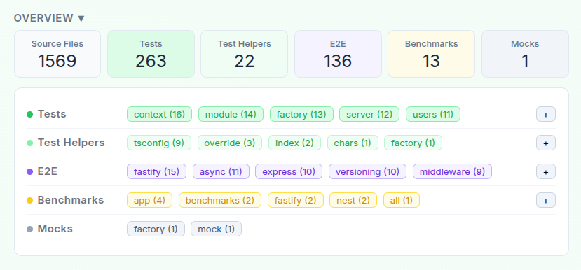
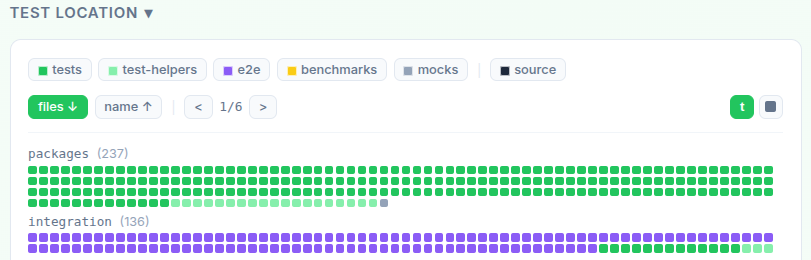
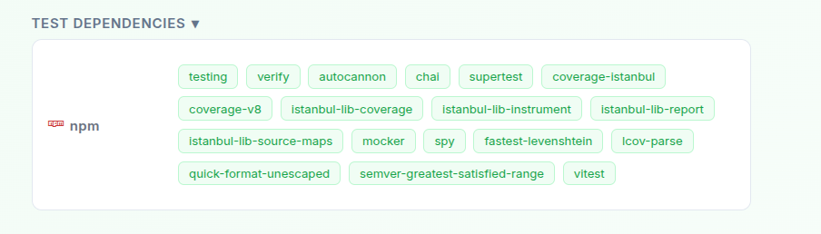
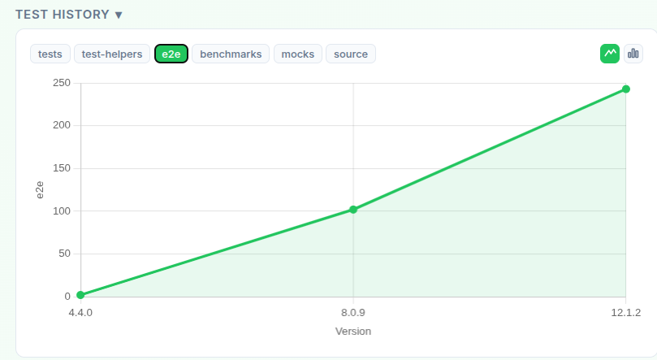

# Explorando Práticas de Teste

Neste exercício, vamos explorar práticas de teste em sistemas reais utilizando a ferramenta [TestMiner](https://andrehora.github.io/testminer).

O TestMiner permite visualizar e analisar testes de software em repositórios do GitHub, fornecendo dados sobre como os projetos organizam seus testes, como eles evoluem entre versões e quais bibliotecas de teste são utilizadas.
Explore a ferramenta antes de começar para se familiarizar com seu funcionamento.

Mais detalhes no GitHub da ferramenta: https://github.com/andrehora/testminer.

---

## Passo 1: Selecionar um repositório

Escolha um repositório real que possua testes de software.
Abaixo estão alguns links para ajudá-lo a encontrar projetos interessantes:

- Python: https://github.com/topics/python?l=python
- JavaScript: https://github.com/topics/javascript?l=javascript
- TypeScript: https://github.com/topics/typescript?l=typescript
- Java: https://github.com/topics/java?l=java

- Tópicos: [ai](https://andrehora.github.io/testminer/#topic:ai), [llm](https://andrehora.github.io/testminer/#topic:llm), [api](https://andrehora.github.io/testminer/#topic:api), [nodejs](https://andrehora.github.io/testminer/#topic:nodejs), [android](https://andrehora.github.io/testminer/#topic:android)

- Por organização: [Google](https://andrehora.github.io/testminer/#google), [Microsoft](https://andrehora.github.io/testminer/#microsoft), [Apple](https://andrehora.github.io/testminer/#apple), [Facebook](https://andrehora.github.io/testminer/#facebook), [Netflix](https://andrehora.github.io/testminer/#netflix), 
[GitHub](https://andrehora.github.io/testminer/#github), [Apache](https://andrehora.github.io/testminer/#apache), [HuggingFace](https://andrehora.github.io/testminer/#huggingface)

## Passo 2: Explorar o repositório selecionado

Busque o repositório escolhido no [TestMiner](https://andrehora.github.io/testminer) e analise os dados de teste gerados pela ferramenta.

## Passo 3: Explicar uma prática de teste

Escolha uma prática ou dado de teste relevante e explique com suas próprias palavras.

---

## Instruções de entrega

1. Faça um `fork` deste repositório (saiba mais sobre forks [aqui](https://docs.github.com/pt/pull-requests/collaborating-with-pull-requests/working-with-forks/fork-a-repo)).
2. Responda às questões abaixo diretamente neste arquivo `README.md` do seu fork. Pode adicionar imagens para enriquecer sua explicação.
3. No Moodle, submeta apenas a URL do seu fork.

---

## Respostas

Repositório: [https://github.com/nestjs/nest](https://github.com/nestjs/nest)

URL TestMiner: [https://andrehora.github.io/testminer/#nestjs/nest](https://andrehora.github.io/testminer/#nestjs/nest)

Explicação: 

Inicialmente, tentei analisar os repositórios do Elastic search, mas recebi um erro de limite da API do GitHub devido ao tamanho do projeto. ENtao optei pelo NestJS, ja que tambem é uma tecnologia que tenho uma certa familiaridade e isso permitiu uma análise completa utilizando a branch main. 
                                                                             
A principal prática de teste que notei no NestJS é a separação e priorização de testes End-to-End (E2E) em relação aos testes de integração.  
                                                                             
No painel "Test Location", é possivel perceber que o projeto divide claramente suas responsabilidades, os testes unitários ficam junto ao código-fonte (na pasta "packages/"), enquanto os testes E2E são totalmente isolados em uma pasta própria chamada "integration/". Uma hipótese para essa arquitetura é facilitar o fluxo de desenvolvimento de testes, ja que os testes unitários ficam próximos do código para agilizar a manutenção por pacote. Já os testes E2E, por testarem o sistema como um todo e serem naturalmente mais lentos, ficam isolados para que possam ser executados em uma etapa separada.
                                                                             

                                                                             
Ja a aba de dependências mostra algumas bibliotecas comuns para desenvolvimento web com Node (pelo menos pela minha experiencia), como por exemplo "supertest" para simular requisições HTTP. Além disso, imagino que o projeto está cheio de testes "E2E" e não possui testes de "integração" é que, como o NestJS é um framework web, a melhor forma de testar se os módulos, middlewares e rotas se integram corretamente é testando o ciclo de vida completo de uma requisição HTTP. Para eles, um teste de integração real já é, por natureza, um teste End-to-End que valida desde a entrada da requisição até a resposta final do servidor.            
                                                                             
 
                                                                             
Por fim, a adoção dessa prática de testes se reflete na evolução do projeto, conforme vai se observando o "Test History", podemos ver que os testes E2E saltaram de praticamente zero (na versão 4.4.0) para mais de 240 arquivos na versão atual. Isso prova que, conforme o framework amadureceu, focar no fluxo de ponta a ponta se tornou a melhor estratégia para garantir a estabilidade do sistema.

 